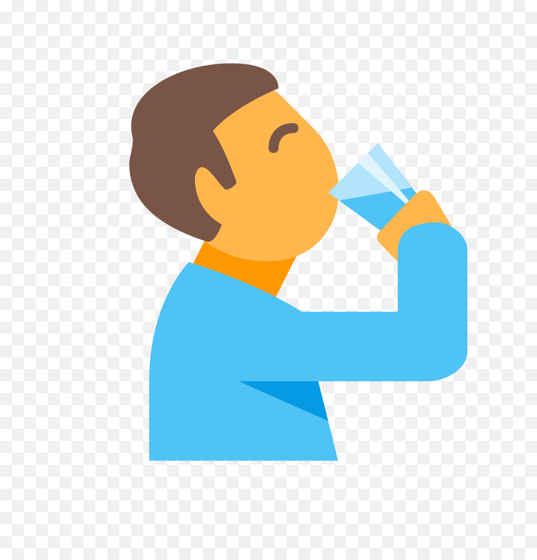

<p align="center">
 
</p>

<h3 align="center">Hydration Reminder</h3>

<div align="center">

[](https://github.com/mmcmd/HydrationReminder/actions/workflows/test.yml)
[](https://github.com/mmcmd/HydrationReminder/issues)
[](LICENCE)

</div>

---

<p align="center">A PowerShell module that reminds you with a Windows notification to drink some water throughout your day. Set it up once and forget about it (but not about drinking).</p>

## 📝 Table of Contents

- [About](#about)
- [Getting Started](#getting_started)
- [Usage](#usage)
- [How it works](#how_it_works)
- [Contributing](CONTRIBUTING.md)
- [Authors](#authors)
- [Acknowledgments](#acknowledgement)

## 🧐 About <a name = "about"></a>

Every hour (by default) between 08:00 and 22:00 you get a notification telling you how much water you should have had by now to hit your daily goal. Snooze or dismiss it right from the notification. Inspired by a Twitch [Hydration bot](https://github.com/Vuurvos1/stayHydratedFox).

## 🏁 Getting Started <a name = "getting_started"></a>

### Prerequisites

- Windows 10 (1809 or later) or Windows 11
- Windows PowerShell 5.1 (built in) or PowerShell 7
- No administrator rights needed

### Installing

From the PowerShell Gallery:

```powershell
Install-Module HydrationReminder -Scope CurrentUser
```

This also installs [BurntToast](https://github.com/Windos/BurntToast), which shows the notifications.

Or from source:

```powershell
Install-Module BurntToast -Scope CurrentUser
git clone https://github.com/mmcmd/HydrationReminder
Import-Module .\HydrationReminder\HydrationReminder.psd1
```

## 🎈 Usage <a name="usage"></a>

```powershell
Start-HydrationReminder     # set it up once with the defaults: every 60 min, 08:00-22:00, 2 L a day
hydrate                     # show a reminder right now (also a quick way to check it works)
```

Customise it by running `Start-HydrationReminder` again with different settings:

```powershell
Start-HydrationReminder -Interval 45 -DailyGoal 2500 -StartTime 07:00 -EndTime 23:00
Start-HydrationReminder -Unit Imperial                 # 64 fl oz a day
Start-HydrationReminder -Unit Imperial -DailyGoal 80
```

Parameter | Default | What it does
----------|---------|-------------
`-Interval` | `60` | Minutes between reminders
`-DailyGoal` | `2000` / `64` | Daily water goal in the chosen unit
`-Unit` | `Metric` | `Metric` (mL / L) or `Imperial` (fl oz)
`-StartTime` | `08:00` | First reminder of the day
`-EndTime` | `22:00` | Last reminder of the day

### Quiet time

```powershell
Suspend-HydrationReminder                  # no more reminders today, back tomorrow
Suspend-HydrationReminder -Minutes 90      # back in 90 minutes
Suspend-HydrationReminder -Until 17:00     # back at 17:00
Suspend-HydrationReminder -Indefinitely    # off until you resume (settings are kept)
Resume-HydrationReminder                   # undo any of the above
Stop-HydrationReminder                     # remove it completely
```

Windows' **Do Not Disturb / Focus** also silences the reminders, which is handy for meetings and games.

Run `Get-Help <command> -Full` on any command for details.

## ⚙️ How it works <a name = "how_it_works"></a>

`Start-HydrationReminder` creates a scheduled task called `HydrationReminder` that runs as you, only while you're logged on. It triggers daily at `StartTime` and repeats every `Interval` minutes until `EndTime`. Each run shows one notification and exits, so nothing keeps running in the background. The console window is hidden with `conhost.exe --headless`.

Settings and pauses are stored in `%LOCALAPPDATA%\HydrationReminder\settings.json`.

After `Update-Module HydrationReminder`, run `Start-HydrationReminder` again so the task uses the new version.

### Upgrading from 1.0

`Register-HydrationReminderTask` and `Unregister-HydrationReminderTask` are gone: `Start-HydrationReminder` and `Stop-HydrationReminder` now manage the task, and `-Duration` is replaced by `-StartTime`/`-EndTime`. A task registered by 1.0 has the same name and is replaced automatically.

## ✍️ Authors <a name = "authors"></a>

- [@mmcmd](https://github.com/mmcmd) - Idea & Initial work

See also the list of [contributors](https://github.com/mmcmd/HydrationReminder/contributors) who participated in this project.

## 🎉 Acknowledgements <a name = "acknowledgement"></a>

- [BurntToast](https://github.com/Windos/BurntToast) for simplifying sending Windows notifications
- Inspired by Twitch's [Hydration bot](https://github.com/Vuurvos1/stayHydratedFox)
